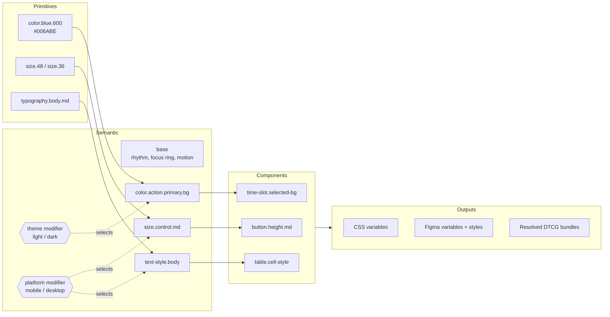

# ClearVisit token architecture and strategy

Status: concept v0.1. Built against DTCG Format Module 2025.10 and Resolver Module 2025.10.

## A. Problem statement

ClearVisit is two products for two very different people. A patient on a phone, often distracted or unwell, needs to answer one question quickly: *when can I be seen?* A scheduling coordinator at a desktop works a dense calendar all day and needs to spot conflicts, pending requests and cancellations at a glance.

Built separately, these products drift. Typical failure modes in scheduling software:

- **Meaning drifts.** "Confirmed" is blue in one product and green in the other; "pending" is amber in a badge but grey in the calendar.
- **Status relies on color alone.** A green/red dot is unreadable for many color-blind users and in bright light.
- **Density leaks across platforms.** A 32px control that is fine with a mouse becomes a missed tap on a phone, or a 48px mobile row wastes a coordinator's screen.
- **Accessibility regresses silently.** A brand tweak drops muted text below 4.5:1 and nobody notices until an audit.
- **Fixes don't travel.** A bug fixed in the admin table never reaches the patient app.

The token system makes each of these a *named decision* that both products consume, and lets the platforms differ only where the difference is justified by input method or information density.

## B. Design principles

| Principle | What it means | How the tokens enforce it |
|---|---|---|
| Clarity before decoration | Every value has a stated job | Semantic names describe role, not appearance |
| Never color alone | Status meaning survives grayscale and color-blindness | Each status ships a label + icon in `$extensions`; pending = dashed, cancelled = struck through |
| Calm, then confident | Neutrals carry the UI; one clear action per view | Brand blue reserved for `color.action.*` and selection |
| One language, two densities | Same vocabulary, platform-appropriate size | Theme and platform are orthogonal resolver modifiers with identical token names |
| Accessible by construction | Contrast is a build requirement | 83 foreground/background pairs per theme audited; the build fails below WCAG 2.2 AA |
| Change in one place | One decision updates both products | Components may not reference primitive colors (build error) |
| Efficiency for operators | Density and scanability for admin work | 40px rows, tabular figures, 12px minimum in calendar events |

## C. Architecture

**Layer rules (enforced by `scripts/build.py`):**

1. Primitives reference only primitives.
2. Semantic tokens reference primitives or other semantic tokens, never components.
3. Components reference semantic tokens. They may reference a primitive *dimension or stroke style* for component-specific geometry (e.g. `date-strip.item-width → size.56`); the build lists these as info. They may never reference a primitive *color*: that is a build error.

**Modifiers (Resolver Module 2025.10).** `tokens/clearvisit.resolver.json` defines:

- sets: `primitives`, `semantic-base`, `components`
- modifier `theme`: `light` (default) | `dark`
- modifier `platform`: `mobile` | `desktop` (default)
- resolution order: primitives → semantic-base → theme → platform → components

That is 2 × 2 = 4 permutations. The two modifiers are **orthogonal**: no token is defined by both, and neither redefines a set token. The build checks this, because non-orthogonal modifiers make the final value depend on array order, which the Resolver spec warns against.

### How references cross file boundaries

DTCG aliases (`{color.blue.600}`) are resolved against the merged token tree, not the file they appear in. The resolver flattens every source for the chosen permutation into one tree first, and only then resolves aliases (Resolver §6.3). So `components/mobile.tokens.json` can reference `size.time-slot`, which only exists in `semantic/platform/*.tokens.json`, which in turn references `size.48` in `primitives/sizing.tokens.json`.

A consequence: **individual files are not standalone-valid.** `semantic/light.tokens.json` alone has dangling references. Tools that load one file at a time (including Figma's importer) need either the resolver, a resolved bundle, or alias metadata. The build emits all three:

- `generated/dtcg/clearvisit.{theme}-{platform}.tokens.json`: one merged, self-contained DTCG file per permutation, aliases preserved.
- `generated/dtcg/clearvisit.bundle.resolver.json`: the resolver with every file reference inlined (Resolver §7.1), so one file carries all four permutations.
- `generated/figma/*.tokens.json`: per-mode files with resolved literals plus `com.figma.aliasData` for cross-collection aliases.

### Scoped re-resolution in CSS

CSS custom properties resolve `var()` where they are **declared**, then inherit the resolved value. If `--cv-button-height-md: var(--cv-size-control-md)` were declared only on `:root`, a `[data-platform="mobile"]` subtree would inherit the desktop answer. The generator therefore re-declares base-semantic and component variables on `:root, [data-theme], [data-platform]`. The same rule applies to inherited properties like `color`: every theme scope resets `color` (see `examples/components.css`). Both behaviours are covered by `tests/test_propagation.py` in Chromium.

## D. Shared vs platform-specific decisions

The test: *if a patient and a coordinator should perceive the same meaning, the token is shared. If the difference comes from input method or information density, it is platform-specific.*

| Shared (theme modifier or base) | Platform-specific (platform modifier) | Mobile | Desktop |
|---|---|---|---|
| All color roles (text, surface, border, action, status, feedback) | `size.control.md` | 48 | 36 |
| Status labels and icons | `size.touch-target` | 48 | 24 |
| Focus ring (2px, 2px offset) | `size.table-row` | 56 | 40 |
| Stroke widths | `size.time-slot` | 48 | 32 |
| Spacing rhythm (`space.inline.*`, `space.stack.*`) | `radius.control` / `radius.card` | 12 / 16 | 6 / 8 |
| Motion and easing | `space.inset.card` / `space.inset.page` | 16 / 16 | 20 / 32 |
| Elevation and z-index layers | `text-style.body` | 16px | 14px |
| | `layout.columns` / gutter | 4 / 16 | 12 / 24 |

Desktop touch target is the WCAG 2.5.8 AA minimum (24px) because admin is pointer-driven. If coordinators use touchscreen kiosks, a third platform context (`kiosk`) would be the right extension, not a change to `desktop`.

## Token inventory

| Layer | File | Tokens |
|---|---|---|
| Primitive | color | 91 (7 hue families × 11 steps, 3 extra neutral steps, white, transparent, 9 alpha) |
| Primitive | typography | 36 (family, 4 weights, 9 sizes, 4 line heights, 3 letter spacings, 15 styles) |
| Primitive | spacing / sizing / radius / border | 13 / 22 / 8 / 7 |
| Primitive | elevation / opacity / motion / layout | 6 / 6 / 10 / 14 |
| Semantic | base | 34 |
| Semantic | theme (per mode) | 99 |
| Semantic | platform (per mode) | 47 |
| Component | shared / mobile / desktop | 114 / 62 / 58 |
| | **Unique paths per permutation** | **627** |

Exact per-token listing: `docs/token-reference.md`. Per-component detail: `docs/component-specs.md`.

## Assumptions (labelled, so they can be replaced)

No existing ClearVisit brand assets were provided, so these are proposals, not brand facts:

1. **Brand blue** (OKLCH hue 252) chosen for trust and calm; teal accent for secondary moments.
2. **Violet for "rescheduled"**: the brief lists six statuses but only four feedback hues; a sixth distinct hue was needed.
3. **Typeface:** Atkinson Hyperlegible Next, for character distinctness in names, times and IDs. Tabular-figure support needs verification in the final font files.
4. **Breakpoints** 600 / 900 / 1200 / 1440; patient app designed at 360–430px, admin at ≥1200px.
5. **Desktop touch target = 24px** (pointer input). Revisit if admin runs on touch devices.

If real brand values arrive, replace primitives in `scripts/define_tokens.py` (or edit the JSON directly) and re-run the build; the contrast audit will flag any semantic mapping that needs to move.
